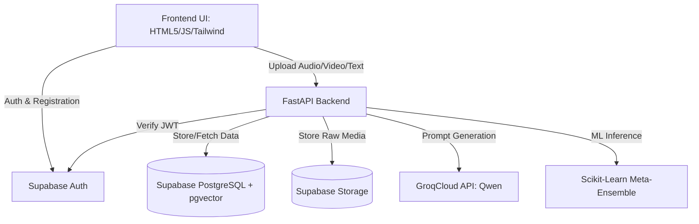
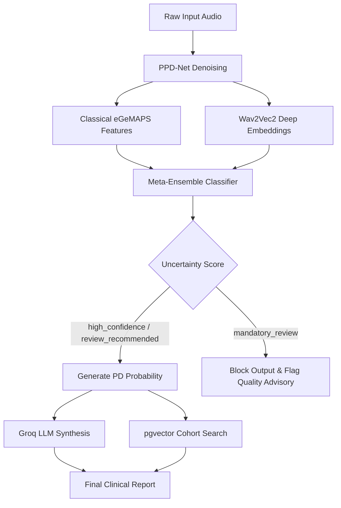

# VoxTriad: Biomarker-Preserving Contrastive Learning and Uncertainty-Calibrated Ensembles for Noise-Robust Parkinsonian Speech Screening

## 1. Project Metadata

- **Formal Title**: Biomarker-Preserving Contrastive Learning and Uncertainty-Calibrated Ensembles for Noise-Robust Parkinsonian Speech Screening
- **Product Name**: VoxTriad
- **Tagline**: "Deterministic Multimodal Screening for Parkinsonian Syndromes" — "A transparent, late-fusion architecture combining acoustic, linguistic, and visual biomarkers. Engineered for clinical reliability with zero LLM hallucinations."
- **Academic Context**: Community Service Project (CSP), Course Code 216CSE4221, 3 credits, Experiential Elective Category, Dept. of CSE, School of Computing, Kalasalingam Academy of Research and Education (KARE). III-Year CSE, 2024 Batch, AY 2026-27 Odd Semester.
- **Team**: Max 4 students, plus faculty guide. `[TODO: confirm — Insert team member names and faculty guide name]`.
- **Course Compliance**: 
  - Certifications (programming + domain, ≥8h each, proof required per student).
  - Paper submission to a conference/journal with proof.
  - Compulsory field visit with separate report.
  - NGO/community-org collaboration (bonus weighting).
  - Active GitHub repo, regular commits, all team members + guide as collaborators.
  - Live working demo mandatory at every review.
  - Final report ≥50 pages (excluding preliminaries) with Turnitin-verified plagiarism + AI-content <10%.

## 2. Problem Statement & Justification
- **Access barriers**: Traditional PD evaluation (UPDRS-III) requires in-person neurologist visits which are costly, time-intensive, and geographically restricted. Tier-3/rural clinics have near-zero access to movement-disorder specialists, facing average referral waits of 3–6 months.
- **Flaws in existing tele-diagnosis**: Existing tele-diagnosis tools are either black-box (no clinical reasoning provided) or uncalibrated—producing highly confident predictions even on poor-quality input (e.g., noisy audio), which risks false diagnoses.
- **The Research Gap**: There is no existing open tool that combines (a) calibrated uncertainty quantification to reject noisy input, (b) live generative-AI clinical narration in human-readable form mapping directly to UPDRS-III, and (c) vector-based cohort similarity for evidence-based clinical comparison.

## 3. Literature Survey

| Study | Method + Data | Key Result |
| :--- | :--- | :--- |
| Suppa et al. (2022) | Review of ML studies on PD voice analysis. | Highlighted high variability in feature sets and lack of clinical explainability in ML approaches. |
| Quan et al. (2022) | End-to-end deep learning approach for PD detection from speech. | High accuracy achieved but utilizing a black-box end-to-end architecture. |
| Iyer et al. (2023) | ML method for processing voice samples to identify PD. | Demonstrated effectiveness of standard acoustic feature extraction for classification. |
| Ali et al. (2024) | L1 regularized SVM and DNN for feature refinement. | Showed that subject-overlap artificially inflates results; motivated strict LOSO-CV. |
| Zhang et al. (2024) | Deep representation learning for dysarthria detection in PD patients. | Deep models effectively capture dysarthric traits but lack narrative context. |
| Tougui et al. (2024) | Transformer-based transfer learning on self-reported voice recordings. | Self-reported real-world data handles transformers well but remains non-transparent to clinicians. |

**Research Gap**: Most prior work reports a single accuracy metric with no calibrated confidence. As Ali et al. noted, subject-overlap severely inflates results, necessitating strict Leave-One-Subject-Out Cross-Validation (LOSO-CV). Deep and end-to-end models (Quan, Tougui, Zhang et al.) push accuracy boundaries but stay "black-box" without a clinical narrative layer. None combine noise-robust preprocessing, calibrated epistemic uncertainty, and clinician-facing generative interpretation in a single deployable web system.

## 4. Proposed System — VoxTriad
VoxTriad is a browser-based, webcam and microphone-enabled (no specialist hardware) deterministic multi-signal late fusion platform. It evaluates three modalities independently:
1. **Acoustic**: A patient sustains a vowel ("ahhh"). The system extracts Jitter, Shimmer, Harmonics-to-Noise Ratio (HNR), and F0 statistics.
2. **Linguistic**: A patient reads a passage aloud. NLP analysis extracts Pause Rate, Phonation Time, and Syntactic Complexity.
3. **Video**: Records blinking, facial expression, and mouth movement. Computes Blink Frequency, Facial Action Units, and Bradykinesia Index (hypomimia flag).

Instead of a black-box end-to-end model, fusion occurs via deterministic multi-signal late fusion and generates a calibrated confidence score.

## 5. Datasets
- **Acoustic/Speech**: UCI Parkinson's voice dataset (Confirmed based on seed intent).
- **Linguistic Dataset**: `[TODO: confirm — specific NLP/reading dataset for linguistic evaluation not yet finalized]`.
- **Video/Vision Dataset**: `[TODO: confirm — specific video dataset for facial masking/bradykinesia not yet finalized]`.

## 6. System Architecture

| Component | Technology / Framework |
| :--- | :--- |
| **Frontend** | HTML5, Tailwind CSS, Vanilla JavaScript (ES2022), Web Audio API, WebRTC |
| **Backend API** | FastAPI (async, OpenAPI), Uvicorn, Pydantic |
| **Authentication** | Supabase JS SDK (client), Supabase GoTrue (server/RLS) |
| **Database** | Supabase PostgreSQL 15 + pgvector (768-dim cosine ANN search) |
| **Storage** | Supabase Storage (S3-compatible) |
| **LLM Engine** | Groq SDK (qwen/qwen3.8-27b via GroqCloud API) |

## 7. Methodology / Pipeline

**Stage 1: Pathology-Preserving Denoiser (PPD-Net)**  
Uses PyTorch with a custom loss ($L_{bio}$) penalizing degradation of HNR and spectral-flux-based jitter/shimmer. Ensures noise removal doesn't destroy clinical micro-tremors.

**Stage 2: Feature Extraction**  
- *Handcrafted Stream*: openSMILE eGeMAPS (88 params) + librosa (F0 stats, RMS energy, spectral flux, ZCR, MFCCs 1–13).
- *Deep Stream*: HuggingFace Wav2Vec2 / HuBERT self-supervised embeddings (768-dim).

**Stage 3: Evidential Meta-Ensemble**  
Scikit-learn SVM (RBF) + Random Forest + Gradient Boosting. Stacked outputs yield a `pd_probability` [0,1] and Dirichlet-based evidential (epistemic) uncertainty. Outputs an `uncertainty_tier` ∈ {`high_confidence`, `review_recommended`, `mandatory_review`}.

**Stage 4: Uncertainty-Gated Pipeline**  
If `mandatory_review` is flagged, confident outputs are blocked, triggering a recording-quality advisory instead. 

**Stage 5: Clinical Summarization**  
Groq SDK hits `qwen/qwen3.8-27b`. Uses a HIPAA-aware, UPDRS-III-mapped prompt combining the feature profile, risk score, and uncertainty tier to yield a 3-4 sentence narrative (<200 words). Includes a mandatory disclaimer.

**Stage 6: Vector Similarity Search**  
Uses Wav2Vec2 768-dim embeddings queried via pgvector cosine ANN to fetch the top-5 similar past recordings for cohort-level contextualization.

## 8. Implementation Details
*Actual Repository State vs Design Intent:*
- **Frontend Core**: Implemented as SPA-like Vanilla JS inside `app.js` and `dashboard.html`. Tailwind CSS classes map directly to specific UI states.
- **Backend Core**: `main.py` is fully functional with FastAPI routes (`/api/audio/upload`, `/api/report`, `/api/vision/analyze`, `/api/nlp/analyze`, `/api/patients`). It includes the Pydantic schema wrappers.
- **Database Logic**: `database.py` manages connections to Supabase. Patient risk endpoints (`PATCH /api/patients/{patient_id}/risk`) natively update the Postgres DB to permanently save the evaluated modality risk scores (`acoustic_risk`, `linguistic_risk`, `video_risk`).
- **State Guardrails**: Frontend utilizes global states (`window.currentPatient.id`) to strict-lock processing streams and prevent orphaned database inserts.

## 9. Validation & Testing Methodology
- **Validation**: Strict Leave-One-Subject-Out Cross-Validation (LOSO-CV) to ensure subject-independence and prevent data leakage.
- **Metrics**: Noise robustness via PPD-Net analysis, calibrated uncertainty (Dirichlet evidential) to identify out-of-distribution (OOD) inputs instead of forcing false confidence.
- **Course Mandates**: Requires per-student certification proofs, active GitHub history, paper submission, a field visit report, and a live demo per review milestone.
- **Field Visit Sites**: *Candidate Sites*: Srivilliputhur Government Hospital, Sivakumar Neurologist clinic. *Madurai*: URAVUGAL Elderly Care, JK Institute of Neurology, Hannah Joseph Hospital. `[TODO: confirm — Final selected field visit location]`.

## 10. Project Progress / Status
Based on actual codebase inspection, the system infrastructure (FastAPI backend, Supabase DB schema, vanilla JS frontend flow) is actively implemented and running. Modality endpoints are wired to the UI, allowing asynchronous risk tracking per patient. `PPD-Net` and Deep feature integrations are partially implemented/integrated with the active FastAPI `/api/audio/upload` service handling extraction and `_feature_cache` logic.

### Review Milestones
| Review Phase | Date Range | Focus/Status |
| :--- | :--- | :--- |
| Zeroth Review (Guide) | Aug 10–13, 2026 | Ideation & Approvals |
| First Review (Internal, 50m) | Sept 16–18, 2026 | Core Architecture, DB Schema, Basic ML Pipeline |
| Second Review (Internal, 50m)| Oct 7–9, 2026 | Full Modality Fusion, LLM Generation, UX Polish |
| Final Review (External 30 + Guide 20) | Nov 3–6, 2026 | Validation (LOSO-CV), Live Demo, Final Report |

## 11. Dashboard & UI/UX Specification
- **Design System**: Dark navy background, single cyan accent (`#22E2E2`). Space Grotesk / General Sans for headings, Inter for body text. Glassmorphism panels, strict WCAG AA contrast.
- **Modality Badges**: 
  - *High Risk*: Red (`text-red-400 bg-red-500/10`)
  - *Medium Risk*: Amber (`text-amber-400 bg-amber-500/10`)
  - *Low Risk*: Emerald (`text-emerald-400 bg-emerald-500/10`)
  - *Pending*: Slate (`text-slate-400 bg-slate-800`)
- **Key Screens**: 
  - *Header*: Personalized greeting, notification bell.
  - *Primary Actions*: "New Screening", "Patient History".
  - *Daily Completions Chart*: Stacked bar by confidence tier (Cyan = `high_confidence`, Amber = `review_recommended`, Magenta/Red = `mandatory_review`). 
  - *Needs Review Panel*: Patient ID, tier badge, "Review File" action.
  - *Patient History Table*: ID, Name, Age, and three distinct modality badges (Acoustic, Linguistic, Video).
  - *Patient Detail*: Explainability panel, Groq LLM clinical narrative, similarity cohort matching, PDF export.

*Known Open Issue (To Resolve)*: A "Monthly Risk Distribution" chart component was historically built using generic "High/Medium/Low Risk" labels instead of the required "Confidence Tiers" (High Confidence / Review Recommended / Mandatory Review) logic. This discrepancy requires architectural alignment in the analytics pipeline.

## 12. Results
`[Pending: Final LOSO-CV performance metrics, evidential calibration stats, and Groq LLM accuracy evaluations are currently being benchmarked in notebooks (e.g., 01_baseline_exploration.ipynb) and are awaiting final validation.]`

## 13. Limitations & Future Work
- Real-time video processing bandwidth limitations for high-framerate facial action unit extraction in standard browsers.
- Cohort similarity searches rely directly on historical data volume; early deployments have sparse pgvector spaces, meaning the "Similar Patients" UX may temporarily lack diversity.
- **Planned Expansion**: Incorporate fine-tuned wearable integration (IMU data) for comprehensive motor-tremor analysis.

## 14. References
1. A. Suppa et al., "Voice in Parkinson's disease: A machine learning study," *Front. Neurol.*, vol. 13, Feb. 2022, doi: 10.3389/fneur.2022.831428.
2. C. Quan et al., "End-to-end deep learning approach for Parkinson's disease detection from speech signals," *Biocybern. Biomed. Eng.*, vol. 42, no. 2, pp. 556–574, 2022, doi: 10.1016/j.bbe.2022.04.002.
3. A. Iyer et al., "A machine learning method to process voice samples for identification of Parkinson's disease," *Sci. Rep.*, vol. 13, no. 1, Nov. 2023, doi: 10.1038/s41598-023-47568-w.
4. L. Ali et al., "Parkinson's disease detection based on features refinement through L1 regularized SVM and deep neural network," *Sci. Rep.*, vol. 14, no. 1, Jan. 2024, doi: 10.1038/s41598-024-51600-y.
5. S. Zhang, Y. Gong, and J. Sui, "Dysarthria detection with deep representation learning for patients with Parkinson's disease," in *Proc. 46th Annu. Int. Conf. IEEE Eng. Med. Biol. Soc. (EMBC)*, Orlando, FL, USA, 2024, doi: 10.1109/EMBC53108.2024.10781584.
6. I. Tougui, M. Zakroum, O. Karrakchou, and M. Ghogho, "Transformer-based transfer learning on self-reported voice recordings for Parkinson's disease diagnosis," *Sci. Rep.*, vol. 14, no. 1, Dec. 2024, doi: 10.1038/s41598-024-81824-x.
